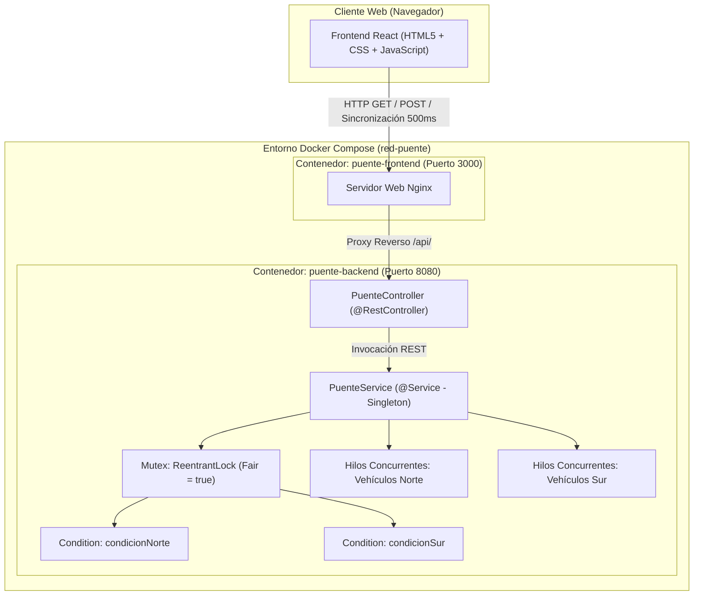

# Práctica APE 03 — Sistemas Distribuidos
## Ejercicio 4: Cruce de Vehículos — Control de Acceso en una Dirección

**Estudiante:** Emilio Jaramillo  
**Asignatura:** Sistemas Distribuidos (6to Ciclo)  
**Docente:** Ing. José O. Guamán Q.  
**Carrera:** Computación — Universidad Nacional de Loja (UNL)  

---

## 1. Descripción del Problema y Objetivos

### Situación
Un puente estrecho de un solo carril permite el paso de vehículos en ambos sentidos (Norte y Sur). Sin embargo, debido a las limitaciones físicas de la vía:
- **Solo puede existir una dirección de circulación activa a la vez.**
- Pueden transitar múltiples vehículos simultáneamente siempre y cuando circulen en el **mismo sentido**.
- **Bajo ninguna circunstancia** pueden circular al mismo tiempo vehículos hacia el Norte y hacia el Sur (riesgo de colisión frontal).
- Cuando no quedan vehículos sobre el puente, este puede alternar su sentido de circulación para dar paso a la fila contraria.

### Criterio de Verificación del Docente
> **Comprobar que nunca crucen vehículos en sentidos opuestos simultáneamente (`!(Norte > 0 && Sur > 0)`).**

### Reto de Concurrencia (Inanición / Starvation)
Si arriban vehículos de forma continua en una misma dirección (ej. Norte), el puente nunca se vacía, impidiendo indefinidamente el cruce de los vehículos que esperan en la dirección contraria (Sur). Se implementó una **política de equidad por lotes (Fair Batching)** que limita el paso consecutivo a un máximo de *N* vehículos cuando hay tráfico esperando en el sentido contrario, garantizando ausencia de inanición (*starvation-free*).

---

## 2. Diagrama de Arquitectura



---

## 3. Estructura del Proyecto

```text
APE03_SD/
├── docker-compose.yml
├── README.md
├── puente-backend/
│   ├── Dockerfile
│   ├── pom.xml
│   ├── mvnw
│   ├── mvnw.cmd
│   ├── .mvn/
│   │   └── wrapper/
│   │       └── maven-wrapper.properties
│   └── src/
│       ├── main/
│       │   ├── java/com/sistemas/distribuidos/puente/
│       │   │   ├── PuenteApplication.java
│       │   │   ├── config/
│       │   │   │   └── WebCorsConfig.java
│       │   │   ├── controller/
│       │   │   │   └── PuenteController.java
│       │   │   ├── dto/
│       │   │   │   ├── EstadoPuenteDto.java
│       │   │   │   ├── SimulacionRequest.java
│       │   │   │   ├── VehiculoRequest.java
│       │   │   │   └── ConfiguracionRequest.java
│       │   │   ├── model/
│       │   │   │   ├── Direccion.java
│       │   │   │   ├── EstadoVehiculo.java
│       │   │   │   ├── Vehiculo.java
│       │   │   │   └── EventoLog.java
│       │   │   └── service/
│       │   │       └── PuenteService.java
│       │   └── resources/
│       │       └── application.properties
│       └── test/
│           └── java/com/sistemas/distribuidos/puente/
│               └── PuenteApplicationTests.java
└── puente-frontend/
    ├── Dockerfile
    ├── nginx.conf
    ├── index.html
    ├── style.css
    ├── app.js
    └── package.json
```

---

## 4. Algoritmo y Mecanismo de Sincronización

### Variables Compartidas
- `direccion = NINGUNA` (`NINGUNA`, `NORTE`, `SUR`)
- `vehiculos_norte = 0` (vehículos en el puente hacia el Norte)
- `vehiculos_sur = 0` (vehículos en el puente hacia el Sur)
- `esperando_norte = 0` (hilos bloqueados esperando turno al Norte)
- `esperando_sur = 0` (hilos bloqueados esperando turno al Sur)
- `MUTEX mutex = 1` (`ReentrantLock(true)`)
- `CONDICION condicion_norte`
- `CONDICION condicion_sur`

### Pseudocódigo Implementado

#### Procedimiento Vehículo Norte
```text
PROCEDIMIENTO vehiculo_norte(id, tiempo_cruce)
    lock(mutex)
    esperando_norte = esperando_norte + 1

    MIENTRAS direccion == SUR O (modo_equitativo Y esperando_sur > 0 Y consecutivos >= LIMITE) HACER
        esperar(condicion_norte)
    FIN MIENTRAS

    esperando_norte = esperando_norte - 1
    direccion = NORTE
    vehiculos_norte = vehiculos_norte + 1
    consecutivos = consecutivos + 1
    verificar_invariante(!(vehiculos_norte > 0 Y vehiculos_sur > 0))

    SI esperando_norte > 0 Y (NO modo_equitativo O consecutivos < LIMITE) ENTONCES
        signal(condicion_norte)
    FIN SI
    unlock(mutex)

    cruzar_puente(tiempo_cruce)

    lock(mutex)
    vehiculos_norte = vehiculos_norte - 1
    SI vehiculos_norte == 0 ENTONCES
        SI esperando_sur > 0 ENTONCES
            direccion = SUR
            consecutivos = 0
            signalAll(condicion_sur)
        SINO SI esperando_norte > 0 ENTONCES
            direccion = NORTE
            consecutivos = 0
            signalAll(condicion_norte)
        SINO
            direccion = NINGUNA
            consecutivos = 0
        FIN SI
    FIN SI
    unlock(mutex)
FIN PROCEDIMIENTO
```

#### Procedimiento Vehículo Sur (Reto Completado)
```text
PROCEDIMIENTO vehiculo_sur(id, tiempo_cruce)
    lock(mutex)
    esperando_sur = esperando_sur + 1

    MIENTRAS direccion == NORTE O (modo_equitativo Y esperando_norte > 0 Y consecutivos >= LIMITE) HACER
        esperar(condicion_sur)
    FIN MIENTRAS

    esperando_sur = esperando_sur - 1
    direccion = SUR
    vehiculos_sur = vehiculos_sur + 1
    consecutivos = consecutivos + 1
    verificar_invariante(!(vehiculos_norte > 0 Y vehiculos_sur > 0))

    SI esperando_sur > 0 Y (NO modo_equitativo O consecutivos < LIMITE) ENTONCES
        signal(condicion_sur)
    FIN SI
    unlock(mutex)

    cruzar_puente(tiempo_cruce)

    lock(mutex)
    vehiculos_sur = vehiculos_sur - 1
    SI vehiculos_sur == 0 ENTONCES
        SI esperando_norte > 0 ENTONCES
            direccion = NORTE
            consecutivos = 0
            signalAll(condicion_norte)
        SINO SI esperando_sur > 0 ENTONCES
            direccion = SUR
            consecutivos = 0
            signalAll(condicion_sur)
        SINO
            direccion = NINGUNA
            consecutivos = 0
        FIN SI
    FIN SI
    unlock(mutex)
FIN PROCEDIMIENTO
```

---

## 5. Respuestas a Preguntas de Análisis y Control

### 1. ¿Por qué el acceso a las variables del puente debe protegerse con un Mutex?
Las variables `direccion`, `vehiculos_norte` y `vehiculos_sur` son leídas y modificadas concurrentemente por múltiples hilos. Si no se protegen con exclusión mutua, una condición de carrera podría provocar que dos hilos en direcciones opuestas lean simultáneamente `direccion == NINGUNA`, ambos cambien la dirección a la suya e ingresen a la vez al puente, produciendo una colisión frontal. El mutex garantiza que cada evaluación y cambio de estado sea una operación atómica.

### 2. ¿Qué es el problema de inanición (starvation) y cómo se solucionó el reto del monopolio?
La inanición ocurre cuando un proceso queda indefinidamente postergado para acceder a un recurso compartido. Si una dirección (por ejemplo Norte) mantiene un flujo continuo de vehículos, el contador de vehículos en el puente nunca llega a 0, haciendo que los vehículos del sentido Sur permanezcan bloqueados para siempre.
**Solución implementada:** Se integró un contador de cruces consecutivos y un límite de lote (*batching*). Cuando se detecta que hay vehículos esperando en el sentido contrario y se alcanza el límite consecutivo, los nuevos vehículos entrantes deben ceder el paso y esperar a que el puente se vacíe para transferir el turno a la cola opuesta.

### 3. Diferencia entre Semáforo Contador, Semáforo Binario y Mutex
- **Mutex (Cerrojo):** Provee exclusión mutua con concepto de propiedad (*ownership*): el mismo hilo que hace `lock()` debe hacer `unlock()`.
- **Semáforo Binario:** Puede valer 0 o 1, pero no posee concepto de propiedad; un hilo puede desbloquear el semáforo que otro bloqueó, sirviendo para señalización entre procesos.
- **Semáforo Contador:** Mantiene un entero no negativo para controlar el acceso a múltiples unidades de un recurso (como en el Ejercicio 1 con 4 espacios de estacionamiento).

---

## 6. Despliegue y Ejecución

### Opción A: Despliegue con Docker Compose (Recomendado)
Para compilar y levantar tanto el Backend (Spring Boot) como el Frontend (React + Nginx) en un solo comando:
```bash
docker compose up --build
```
Una vez levantado:
- **Frontend Web interactivo:** `http://localhost:3000`
- **Backend API REST:** `http://localhost:8080/api/puente/estado`

Para detener los servicios:
```bash
docker compose down
```

### Opción B: Ejecución Manual Local

#### 1. Backend (Spring Boot)
```bash
cd puente-backend
./mvnw spring-boot:run
```
*(O en Windows: `mvnw.cmd spring-boot:run`)*

#### 2. Frontend
Abrir directamente `puente-frontend/index.html` en cualquier navegador web moderno, o servirlo con cualquier servidor estático:
```bash
cd puente-frontend
python -m http.server 3000
```
Visitar `http://localhost:3000`.

---

## 7. Verificación del Criterio de Evaluación
Al pulsar **"🚀 Simular 10 Vehículos Simultáneos (5 Norte / 5 Sur)"**:
1. Los vehículos arriban de forma aleatoria y concurrente.
2. El sistema adquiere el mutex y asigna el sentido inicial al primer sentido listo.
3. Los vehículos del sentido opuesto se bloquean de manera segura en `wait()` y se muestran en la sección de espera de la interfaz.
4. El puente permite cruzar a vehículos del mismo sentido.
5. Al vaciarse el puente (o alcanzar el límite de equidad), la dirección cambia y los vehículos esperando en la dirección contraria son despertados mediante `signalAll()`.
6. En todo momento el monitor valida `colisionDetectada == false` y `0 Colisiones`, certificando el cumplimiento del criterio de evaluación.
