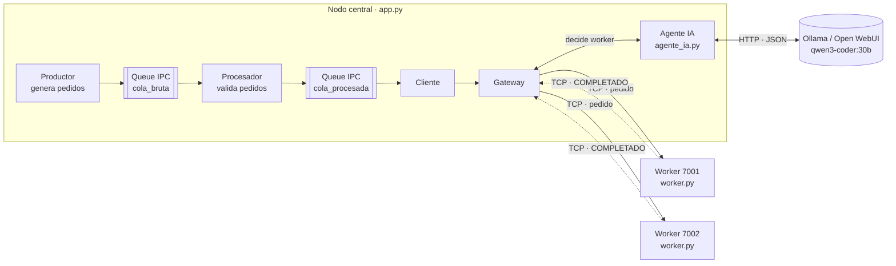

<div align="center">

#  Sistema Distribuido de Asignación de Pedidos

### APE 4 · Comunicación Inter-Proceso (IPC) y en Red con Agente de IA


**Universidad Nacional de Loja** · Carrera de Computación · Sistemas Distribuidos · 6.º ciclo

**Docente:** Ing. José Guamán  **Autor:** Alexander Sánchez

</div>

---

##  Contenido

- [Descripción](#descripción)
- [Arquitectura](#arquitectura)
- [Tecnologías](#tecnologías)
- [Estructura del proyecto](#estructura-del-proyecto)
- [Componentes](#componentes)
- [Ejecución](#ejecución)
- [Salida esperada](#salida-esperada)
- [Agente de IA](#agente-de-ia)
- [Ejecución en varias computadoras](#ejecución-en-varias-computadoras)
- [Preguntas de control](#preguntas-de-control)

---

##  Descripción

Esta práctica simula un sistema de **asignación de pedidos tipo delivery** que combina dos formas de comunicación:

- **Entre procesos (IPC):** un proceso genera pedidos y otro los valida; se comunican mediante colas `multiprocessing.Queue`.
- **Entre computadoras (red):** el gateway envía cada pedido por **sockets TCP** al nodo trabajador elegido, que responde con una confirmación.

La decisión de qué *worker* atiende cada pedido la toma un **agente de IA** (modelo `qwen3-coder:30b` servido por Ollama / Open WebUI), que evalúa la distancia, la prioridad y la carga de cada nodo. Si la IA no está disponible, el gateway aplica una **regla fija de respaldo** (menor carga) y el sistema sigue funcionando.

---

##  Arquitectura



**Flujo de un pedido:**

1. El **productor** (proceso independiente) crea un pedido con `id_pedido`, `distancia_km`, `prioridad` e `items` y lo coloca en `cola_bruta`.
2. El **procesador** (otro proceso) lo extrae, lo marca como `VALIDADO_IPC` y lo deja en `cola_procesada`.
3. El proceso principal lo toma y el **cliente** lo entrega al **gateway**.
4. El gateway consulta al **agente de IA** con el pedido y el estado de los workers (carga y distancia).
5. El gateway abre un **socket TCP** hacia el worker elegido y le envía el pedido en JSON.
6. El **worker** simula el procesamiento (1,5 s) y responde `{"status": "COMPLETADO", ...}`.

---

##  Tecnologías

| Tecnología | Uso |
|:--|:--|
| Python 3 | Lenguaje de todo el sistema |
| `multiprocessing` (`Process`, `Queue`) | Comunicación entre procesos (IPC) |
| `socket` | Comunicación TCP gateway ↔ workers |
| `json` | Serialización de los pedidos |
| `requests` | Llamadas HTTP a la API del modelo de IA |
| Ollama / Open WebUI | Servidor del modelo `qwen3-coder:30b` (provisto por la carrera) |

---

##  Estructura del proyecto

```
APE4_Alexander_Sanchez/
├── README.md
├── ape_guia 4 distribuidos-signed-signed-firmado.pdf   # Guía de la práctica
└── ape/
    ├── requirements.txt
    ├── cliente_system/
    │   ├── app.py                      # Punto de entrada: IPC + gateway
    │   ├── cliente.py                  # Entrega cada pedido al gateway
    │   └── ipc_system/
    │       ├── main.py                 # (vacío, integrado en app.py)
    │       └── controls/
    │           ├── productor.py        # Genera pedidos → Queue
    │           └── procesador.py       # Valida pedidos ← Queue → Queue
    ├── gateway-system/
    │   ├── gateway.py                  # Enrutamiento TCP hacia los workers
    │   ├── agente_ia.py                # Prompt + llamada al modelo + respaldo
    │   └── test_qwen.py                # Prueba de conexión con el modelo
    ├── servidores-system/
    │   └── worker.py                   # Nodo trabajador TCP
    ├── gateway/                        # Versión inicial (gateway TCP :6000 + Round Robin)
    │   ├── conexionAPI.py
    │   └── pruebaConexionAPI.py
    ├── conexionAPI.python              # Borrador de la versión inicial
    └── opencode.json                   # Configuración de OpenCode con el modelo de la carrera
```

> La versión final que se ejecuta es `cliente_system/app.py` + `servidores-system/worker.py`. La carpeta `gateway/` conserva la primera versión, en la que el gateway escuchaba en el puerto 6000 y clasificaba datos como CRITICO/NORMAL.

---

##  Componentes

| Componente | Archivo | Tipo | Función |
|:--|:--|:--|:--|
| Productor | `ipc_system/controls/productor.py` | Proceso | Genera pedidos aleatorios cada 1 s |
| Procesador | `ipc_system/controls/procesador.py` | Proceso | Valida y reenvía pedidos entre colas |
| Cliente | `cliente_system/cliente.py` | Clase | Transfiere el pedido al gateway |
| Gateway | `gateway-system/gateway.py` | Clase | Pide la decisión a la IA y envía por TCP |
| Agente IA | `gateway-system/agente_ia.py` | Módulo | Arma el prompt y devuelve el worker elegido |
| Worker | `servidores-system/worker.py` | Servidor TCP | Recibe, procesa y confirma pedidos |

**Puertos**

| Servicio | Puerto | Protocolo |
|:--|:--|:--|
| Worker 1 | `7001` | TCP |
| Worker 2 | `7002` | TCP |
| API del modelo de IA | según servidor (`IA_URL`) | HTTP |

---

##  Ejecución

### Requisitos

- Python 3.8 o superior
- Librería `requests`

```bash
git clone https://github.com/AlexanderSanchezCS/Portafolio-Sistemas-Distribuidos.git
cd Portafolio-Sistemas-Distribuidos/APE4_Alexander_Sanchez/ape
pip install -r requirements.txt
```

### 1. Levantar los workers

Cada worker en su propia terminal, desde la carpeta `ape/`:

```bash
python servidores-system/worker.py 7001
```

```bash
python servidores-system/worker.py 7002
```

### 2. (Opcional) Configurar el agente de IA

Sin esta configuración el sistema funciona igual, usando la regla de respaldo.

```bash
# Linux / macOS
export IA_URL="http://<servidor>:3000/api/chat/completions"
export IA_API_KEY="<tu_api_key>"
```

```powershell
# Windows (PowerShell)
$env:IA_URL="http://<servidor>:3000/api/chat/completions"
$env:IA_API_KEY="<tu_api_key>"
```

Para comprobar la conexión con el modelo antes de ejecutar:

```bash
python gateway-system/test_qwen.py
```

### 3. Iniciar el sistema central

En una tercera terminal, desde `ape/`:

```bash
python cliente_system/app.py
```

El sistema genera 3 pedidos, los asigna y termina con `[Sistema Central] Proceso completado exitosamente.`

---

##  Salida esperada

**Sistema central** (sin IA configurada, usando la regla de respaldo):

```text
==================================================
INICIANDO SISTEMA DISTRIBUIDO (APE 4)
==================================================
[IPC - Productor] Pedido generado: PED-101 (9.75 km)
[IPC - Procesador] Pedido PED-101 verificado e ingresado a memoria.
[Cliente] Transfiriendo pedido PED-101 al Gateway...

[Gateway] Evaluando asignación para pedido PED-101...
[Agente IA Error] IA_URL no configurada. Aplicando regla fija de respaldo.
[Gateway -> IA] Asignado a Worker_7002. Motivo: Respaldo: Menor carga
[Gateway TCP] Confirmación de Worker 7002: {"status": "COMPLETADO", "nodo": 7002, "id_pedido": "PED-101"}
...
[Sistema Central] Proceso completado exitosamente.
```

**Worker 7002:**

```text
[WORKER EN LÍNEA] Escuchando en puerto: 7002

[Worker 7002] Recibido Pedido: PED-101 (9.75 km)
```

Con la IA configurada, la línea del gateway muestra el motivo que da el modelo, por ejemplo:
`[Gateway -> IA] Asignado a Worker_7001. Motivo: Pedido de alta prioridad y worker más cercano`.

---

##  Agente de IA

El agente recibe el pedido y el estado de los nodos, y debe responder **solo** con un JSON:

```json
{ "worker_seleccionado": "7001", "razon": "explicación breve" }
```

**Información enviada en el prompt:**

| Dato | Origen |
|:--|:--|
| ID, distancia y prioridad del pedido | Productor |
| Distancia de cada worker | `estado_workers` en `app.py` |
| Carga actual de cada worker | `estado_workers` en `app.py` |

**Regla de respaldo:** si la API no responde, devuelve un error o el texto no es un JSON válido, se elige el worker con **menor carga**. Así el sistema nunca se detiene por una falla de la IA.

| Criterio | Agente de IA | Regla fija |
|:--|:--|:--|
| Considera varios factores a la vez | ✓ distancia, prioridad y carga | Solo carga |
| Explica la decisión | ✓ campo `razon` | ✗ |
| Latencia | Segundos por pedido | Inmediata |
| Resultado predecible | ✗ puede variar | ✓ |
| Depende de un servicio externo | ✓ | ✗ |

---

##  Ejecución en varias computadoras

1. En cada computadora remota, copiar `servidores-system/worker.py` y ejecutarlo con su puerto.
2. Obtener la IP de esa computadora (`ip a` en Linux, `ipconfig` en Windows).
3. En la computadora central, editar `red_workers` en `cliente_system/app.py`:

```python
red_workers = {
    "7001": ("192.168.0.50", 7001),   # IP de la computadora del worker 1
    "7002": ("192.168.0.51", 7002)    # IP de la computadora del worker 2
}
```

4. Todas las computadoras deben estar en la misma red y permitir conexiones entrantes en los puertos `7001` y `7002` del firewall.

---

##  Preguntas de control

<details>
<summary><b>1. ¿Qué diferencia hay entre la comunicación IPC y los sockets TCP?</b></summary>
<br>
La cola IPC (<code>multiprocessing.Queue</code>) comunica procesos dentro de la misma máquina; el sistema operativo gestiona el intercambio y no hay red de por medio. Los sockets TCP comunican procesos en máquinas distintas a través de la red, con direcciones IP y puertos, y requieren serializar los datos (aquí en JSON).
</details>

<details>
<summary><b>2. ¿Por qué el agente de IA y el generador pueden estar en computadoras distintas sin compartir memoria?</b></summary>
<br>
Porque no comparten variables: se comunican por mensajes. El pedido viaja serializado en JSON por HTTP o TCP, y cada lado reconstruye el objeto a partir del mensaje. Todo lo que el receptor necesita debe ir dentro del mensaje.
</details>

<details>
<summary><b>3. ¿Qué información debe viajar para que el agente decida bien? ¿Qué pasa si falta la carga del nodo?</b></summary>
<br>
Los datos del pedido (distancia y prioridad) y el estado de cada worker (distancia y carga actual). Si falta la carga, el agente no puede balancear el trabajo y tiende a enviar todo al nodo más cercano, saturándolo mientras el otro queda libre.
</details>

<details>
<summary><b>4. ¿Qué ocurre si un worker se desconecta mientras hay pedidos en la cola?</b></summary>
<br>
El gateway intenta conectarse, falla tras el <i>timeout</i> de 5 s y registra <code>[Gateway TCP Error]</code>. El pedido se pierde porque no hay reintento ni reasignación. Una mejora sería reintentar con el otro worker o devolver el pedido a la cola.
</details>

<details>
<summary><b>5. ¿Cuándo aporta valor un agente de IA frente a reglas fijas y cuándo no?</b></summary>
<br>
Aporta valor cuando hay muchos criterios que se combinan (distancia, prioridad, carga, tráfico) y escribir reglas para todos los casos es difícil. No conviene cuando se necesita una respuesta inmediata, determinista y auditable, o cuando la regla es simple: en esos casos la regla fija es más rápida y confiable.
</details>

---

<div align="center">

Universidad Nacional de Loja · 2026

</div>
