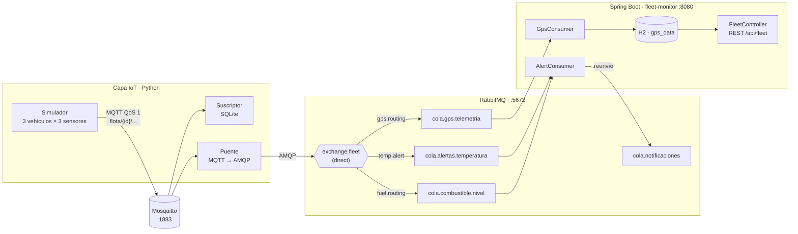

<div align="center">

#  Sistema Integral de Monitoreo de Flota

### APE 6 · IoT + Microservicios con MQTT y RabbitMQ


**Universidad Nacional de Loja** · Carrera de Computación · Sistemas Distribuidos · 6.º ciclo

**Docente:** Ing. José Guamán  **Autor:** Alexander Sánchez

</div>

---

##  Contenido

- [Descripción](#-descripción)
- [Arquitectura](#-arquitectura)
- [Tecnologías](#-tecnologías)
- [Estructura del proyecto](#-estructura-del-proyecto)
- [Servicios y puertos](#-servicios-y-puertos)
- [Mensajería en RabbitMQ](#-mensajería-en-rabbitmq)
- [Ejecución](#-ejecución)
- [Verificación](#-verificación)
- [API REST](#-api-rest)
- [Persistencia](#-persistencia)
- [Evolución desde la APE 5](#-evolución-desde-la-ape-5)

---

##  Descripción

Esta práctica integra dos capas de un sistema distribuido para monitorear una flota logística:

- **Capa IoT:** sensores simulados en Python publican GPS, temperatura y combustible por **MQTT**.
- **Capa de microservicios:** un servicio **Spring Boot** consume esos datos desde **RabbitMQ**, los guarda con JPA y los expone por una **API REST**.

Un puente en Python une ambos mundos: escucha MQTT y reenvía cada lectura a la cola de RabbitMQ que le corresponde según su tipo y su umbral de alerta.

---

##  Arquitectura



**Flujo de un mensaje:**

1. El simulador publica una lectura en el tópico `flota/{id}/{sensor}`.
2. Mosquitto la entrega al suscriptor (que la guarda en SQLite) y al puente.
3. El puente la publica en `exchange.fleet` con la routing key que corresponde.
4. Spring Boot la consume: el GPS se guarda en H2 y las alertas se reenvían a `cola.notificaciones`.
5. La API REST consulta H2 y devuelve el estado de la flota.

---

##  Tecnologías

| Capa | Tecnología | Uso |
|:--|:--|:--|
| IoT | Python 3.11 · `paho-mqtt` | Simulador y suscriptor MQTT |
| Puente | Python 3.11 · `pika` | Reenvío de MQTT a AMQP |
| Broker IoT | Eclipse Mosquitto | Mensajería MQTT liviana |
| Broker empresarial | RabbitMQ + Management | Exchange, colas y enrutamiento |
| Microservicio | Spring Boot 3.1.5 · Java 17 | Spring AMQP, Spring Data JPA, Spring Web |
| Persistencia | SQLite · H2 | Histórico IoT y telemetría del microservicio |
| Despliegue | Docker · Docker Compose | Orquestación de toda la pila |

---

##  Estructura del proyecto

```text
APE6_Alexander_Sanchez/
├── docker-compose.yml                  # Pila completa (red host)
├── infra/
│   ├── docker-compose.yml              # Solo Mosquitto + RabbitMQ
│   └── mosquitto/config/mosquitto.conf # Listener 1883 y persistencia
└── services/
    ├── python/
    │   ├── simulador_sensores.py       # 3 vehículos × 3 sensores, QoS 1
    │   ├── suscriptor_almacenamiento.py# SQLite + detección de alertas
    │   ├── bridge.py                   # MQTT → RabbitMQ (4 colas)
    │   ├── requirements.txt
    │   ├── Dockerfile.simulador
    │   └── Dockerfile.bridge
    └── spring-boot/fleet-monitor/
        ├── Dockerfile                  # Multi-stage: Maven + JRE 17
        ├── pom.xml
        └── src/main/java/com/fleet/monitor/
            ├── config/RabbitMQConfig.java       # Exchange, colas y bindings
            ├── consumer/GpsConsumer.java        # cola.gps.telemetria → H2
            ├── consumer/AlertConsumer.java      # Alertas → cola.notificaciones
            ├── model/GpsMessage.java            # DTO del mensaje JSON
            ├── model/GpsEntity.java             # Entidad JPA (gps_data)
            ├── repository/GpsRepository.java    # Consultas JPA
            └── controller/FleetController.java  # API REST
```

---

##  Servicios y puertos

| Servicio | Contenedor | Puerto | Descripción |
|:--|:--|:--:|:--|
|  Mosquitto | `mosquitto_broker` | `1883` · `9001` | Broker MQTT (TCP y WebSocket) |
|  RabbitMQ | `rabbitmq_broker` | `5672` · `15672` | AMQP y panel de administración |
|  Puente | `mqtt_rabbitmq_bridge` | — | MQTT `flota/#` → RabbitMQ |
|  Simulador | `simulador_sensores` | — | Publica cada 5 segundos |
|  Fleet Monitor | `fleet_monitor` | `8080` | Consumidores + API REST |

> **Credenciales de RabbitMQ:** `admin` / `admin123` (definidas en `docker-compose.yml`, solo para entorno local).

---

##  Mensajería en RabbitMQ

Exchange **`exchange.fleet`** de tipo **direct**:

| Cola | Routing key | Publica | Consume | Condición |
|:--|:--|:--|:--|:--|
| `cola.gps.telemetria` | `gps.routing` | Puente | `GpsConsumer` → H2 | Toda lectura GPS |
| `cola.alertas.temperatura` | `temp.alert` | Puente | `AlertConsumer` | Temperatura > 4 °C |
| `cola.combustible.nivel` | `fuel.routing` | Puente | `AlertConsumer` | Combustible < 20 % |
| `cola.notificaciones` | — | `AlertConsumer` | Consumidor futuro | Reenvío de alertas |

---

##  Ejecución

### Requisitos

- Docker y Docker Compose
- Linux (la pila usa `network_mode: host`)

### Levantar toda la pila

```bash
docker compose up --build -d
docker compose ps
```

### Ver los logs

```bash
docker compose logs -f simulador_sensores
docker compose logs -f mqtt_rabbitmq_bridge
docker compose logs -f fleet_monitor
```

### Panel de RabbitMQ

Abre <http://localhost:15672> e ingresa con `admin` / `admin123`.

### Detener

```bash
docker compose down
```

<details>
<summary><b>▶ Ejecución manual (sin contenedores para los servicios)</b></summary>

<br>

```bash
# 1. Solo infraestructura
cd infra && docker compose up -d

# 2. Capa IoT (cada script en su propia terminal)
cd ../services/python
pip install -r requirements.txt
python simulador_sensores.py
python bridge.py
python suscriptor_almacenamiento.py

# 3. Microservicio
cd ../spring-boot/fleet-monitor
mvn spring-boot:run
```

</details>

---

##  Verificación

| # | Qué revisar | Resultado esperado |
|:--:|:--|:--|
| 1 | Logs del simulador | `Ronda completada (9 mensajes enviados)` |
| 2 | Logs del puente | `GPS enviado` y alertas de temperatura y combustible |
| 3 | Logs de Spring Boot | `GPS guardado: VH-001` y `ALERTA ...` |
| 4 | API REST | Respuesta JSON con el estado de la flota |
| 5 | Colas de RabbitMQ | Mensajes y consumidores en cada cola |

```bash
docker exec rabbitmq_broker rabbitmqctl list_queues name messages consumers
```

---

##  API REST

| Método | Endpoint | Descripción |
|:--:|:--|:--|
| `GET` | `/api/fleet/status` | Resumen de la flota |
| `GET` | `/api/fleet/vehicle/{id}/telemetria` | Historial GPS de un vehículo |

```bash
curl http://localhost:8080/api/fleet/status
```

```json
{ "totalVehicles": 3, "activeAlerts": 0, "timestamp": "2026-11-10T..." }
```

```bash
curl http://localhost:8080/api/fleet/vehicle/VH-001/telemetria
```

```json
[
  { "vehicleId": "VH-001", "lat": -2.1701, "lng": -79.921, "speed": 45.2, "timestamp": "..." }
]
```

---

##  Persistencia

| Componente | Motor | Tablas |
|:--|:--|:--|
| Suscriptor Python | SQLite · `telemetria.db` | `gps_data`, `temp_data`, `fuel_data` |
| Fleet Monitor | H2 embebido | `gps_data` |

---

##  Evolución desde la APE 5

| Aspecto | APE 5 | APE 6 |
|:--|:--|:--|
| Alcance | Solo capa IoT | IoT + microservicio Spring Boot |
| Colas | 3 | 4 (se agrega `cola.notificaciones`) |
| Consumo de RabbitMQ | ✗ | ✓ `GpsConsumer` y `AlertConsumer` |
| Enrutamiento | Colas directas | `exchange.fleet` con bindings |
| API REST | ✗ | ✓ `/api/fleet/*` |
| Base de datos | SQLite | SQLite + H2 con JPA |
| Red Docker | Bridge con puertos | Host |

---

<div align="center">

Universidad Nacional de Loja · 2026

</div>
