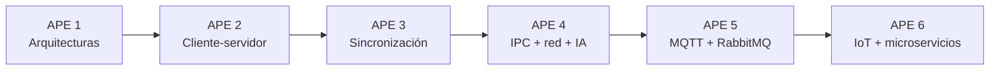

<div align="center">

# Portafolio de Sistemas Distribuidos

**Alexander Sánchez** · Ingeniería en Computación · Universidad Nacional de Loja

Sistemas Distribuidos · 6.º ciclo · Docente: Ing. José Guamán


</div>

---

## Actividades práctico-experimentales (APE)

| APE | Tema | Tecnologías |
|:--:|:--|:--|
| [**1**](APE1_Alexander_Sanchez) | Arquitecturas de sistemas distribuidos | Informe |
| [**2**](APE2_Alexander_Sanchez) | Cliente-servidor con archivos | Python · archivos de texto |
| [**3**](APE3_Alexander_Sanchez) | Sincronización de procesos: exclusión mutua, semáforos y problemas clásicos de concurrencia | Spring Boot · JavaScript · Docker |
| [**4**](APE4_Alexander_Sanchez) | Comunicación inter-proceso (IPC) y en red con agente de IA | Python · `multiprocessing` · TCP · Ollama |
| [**5**](APE5_Alexander_Sanchez) | De los sensores a las colas: MQTT + SQLite + RabbitMQ | Python · Mosquitto · SQLite · RabbitMQ |
| [**6**](APE6_Alexander_Sanchez) | Sistema integral de monitoreo de flota: IoT + microservicios | Python · Spring Boot · RabbitMQ · Docker |

Cada carpeta contiene el informe en PDF y, en las prácticas con código, el código fuente y un `README.md` con las instrucciones de ejecución.

---

## Recorrido del curso



Las prácticas avanzan desde los conceptos de arquitectura hacia sistemas completos: primero la comunicación cliente-servidor, luego la coordinación entre hilos y procesos, la comunicación por red con un agente de IA, después la mensajería asíncrona con brokers y, al final, la integración de IoT con microservicios en contenedores.

---

## Uso

```bash
git clone https://github.com/AlexanderSanchezCS/Portafolio-Sistemas-Distribuidos.git
cd Portafolio-Sistemas-Distribuidos
```

Luego se entra a la carpeta de la práctica y se siguen los pasos de su `README.md`.

---

<div align="center">

Universidad Nacional de Loja · 2026

</div>
